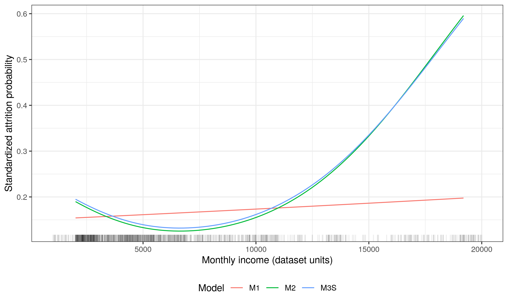
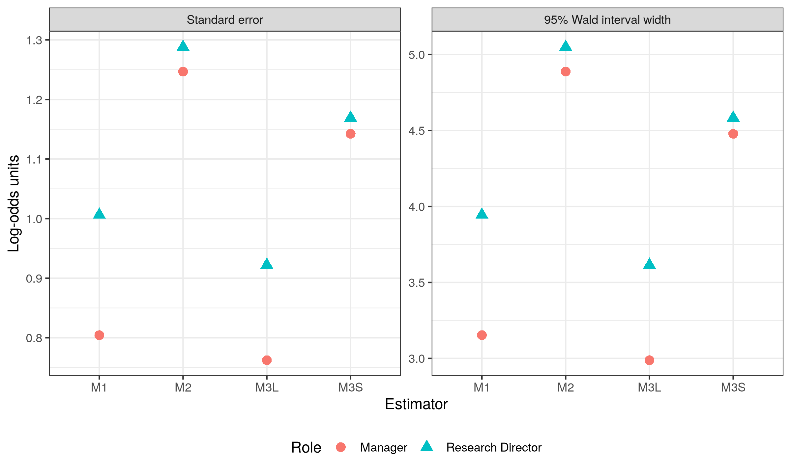
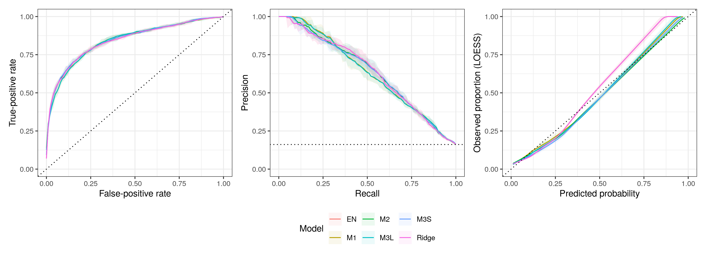
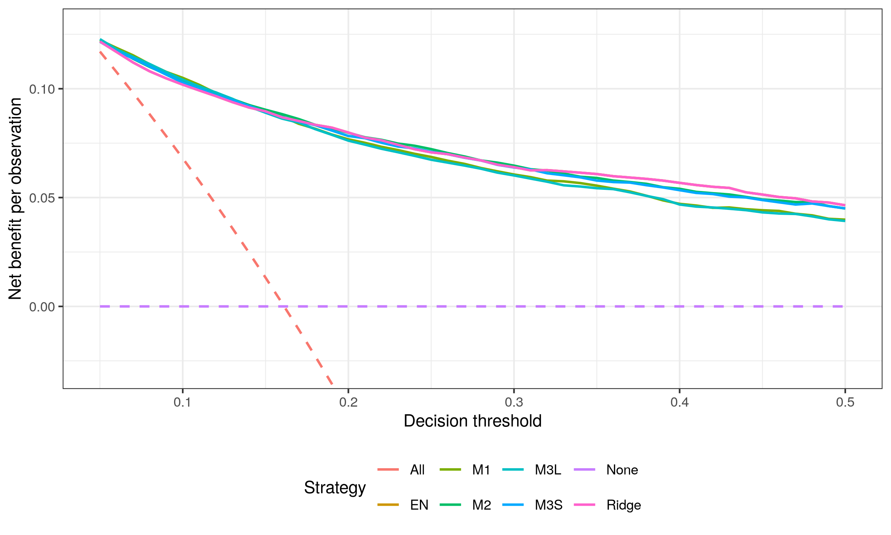

```{r analysis, include=FALSE}
knitr::opts_chunk$set(echo=FALSE, error=FALSE)
source("study-design.R")
source("inference.R")
source("prediction.R")
source("evaluation.R")
source("figures.R")
d <- load_ibm()
a <- infer(d)
oof <- outer_predictions(d)
e <- evaluate(oof)
make_figures(d,a,e)
tab <- function(x, ...) knitr::kable(x, digits=3, ...)
nb <- reshape(aggregate(NB ~ model + threshold,e$dca,mean),idvar="threshold",timevar="model",direction="wide")
paired <- reshape(e$scores[,c("rep","fold","model","LogLoss")],idvar=c("rep","fold"),timevar="model",direction="wide")
paired <- merge(paired, unique(oof[c("rep","fold","separated_M1","separated_M2")]),by=c("rep","fold"))
pair_delta <- paired$LogLoss.Ridge-paired$LogLoss.M2
score <- function(model, metric) sprintf("%.3f", mean(e$scores[[metric]][e$scores$model == model]))
threshold_ranges <- function(t) {
  if (!length(t)) return("no evaluated thresholds")
  groups <- split(t,cumsum(c(TRUE,diff(round(t*100)) != 1)))
  paste(vapply(groups,function(g) paste(sprintf("%.2f",unique(range(g))),collapse="–"),character(1)),
        collapse=" and ")
}
superior <- with(nb,threshold[NB.Ridge > pmax(NB.All, NB.None, NB.M1, NB.M2)])
positive <- with(nb,threshold[NB.Ridge > 0])
```

# Abstract

A classifier that predicts no departures correctly labels almost 84% of records in the fictional IBM employee attrition dataset. This benchmark therefore offers a useful test of whether adding model complexity improves estimated probabilities or would change a threshold decision. We analysed 1,470 profiles with 237 departures. We compared linear and natural spline maximum likelihood logistic regression, mean bias reduction under Firth's method, and spline models with ridge or elastic-net penalties. We separated full-sample contrasts from prediction and repeated stratified fivefold validation ten times, choosing penalties by log-loss within each outer training split. The linear and ridge models achieved mean ROC areas of `r score("M1","AUC")` and `r score("Ridge","AUC")` and average precision of `r score("M1","AP")` and `r score("Ridge","AP")`, respectively. The mean calibration slope rose from `r score("M1","Slope")` to `r score("Ridge","Slope")`, while the integrated calibration index rose from `r score("M1","ICI")` to `r score("Ridge","ICI")`. The elastic-net search selected ridge in all fifty splits. Ridge had positive mean net benefit at thresholds of `r threshold_ranges(positive)` and exceeded both default strategies and both maximum likelihood models at thresholds of `r threshold_ranges(superior)` on the specified grid. These gains depended on the performance measure and the assumed cost of a false alert. The synthetic records support a comparison of statistical procedures under internal validation. Their provenance and cross-sectional structure preclude conclusions about the effectiveness of employee retention interventions.

# Introduction

Imagine acting on every model prediction above a risk of one in five. To justify the decision one would want to know whether people given that probability actually experience the outcome at about that frequency. Knowing only that a model ranks a departing employee above a continuing employee in most pairs leaves that question open. Knowing how often a binary label is correct says even less when most employees stay. The IBM HR sample makes these distinctions unusually easy to examine. It is publicly available, has a minority outcome of manageable size, and includes variables whose meanings overlap enough to challenge an ordinary regression. It also has a clear limit. The sample consists of fictional profiles, so an apparently accurate model cannot establish who would leave an actual employer.

Published analyses of the same benchmark have asked different questions. Yang and Islam used clustering, importance rankings and binary logistic regression to investigate attrition. In their Table 5, the human resources department and human resources role coefficients have opposite signs and the same reported standard error of 10,790.424. The role odds ratio exceeds 44 million. The table also includes the employee identifier and pay-rate fields discussed in preprocessing. Which columns enter the fitted equation matters for interpretation, particularly where roles almost identify departments. Their random forest averaged 84.56% accuracy across 100 random training/test splits, compared with 83.88% for the dataset-wide majority rule. The difference of 0.68 percentage points says little about how many departures were correctly identified. The regression uncertainty warrants inspecting support and the design matrix before interpreting a point estimate. It does not establish separation in another specification. [Yang and Islam, author manuscript](https://arxiv.org/pdf/2012.01286).

Tang, Gu and Kelkar compared ten supervised models and examined synthetic minority oversampling. Their emphasis on random forests and feature importance raises a different evaluation question. If class proportions are changed in training, an investigator interested in probabilities must still measure calibration on observations drawn at the original prevalence. Ma and colleagues instead compared a fine-tuned language model with familiar tabular classifiers and emphasized precision, recall and F1. These endpoints describe a particular classification task. They do not specify when the value of identifying a departure would justify the cost of incorrectly flagging another person. Nor should published rankings from different partitions and preprocessing pipelines be combined into a single league table. [Tang et al., 2025](https://doi.org/10.33423/jabe.v27i3.7644) and [Ma et al., 2024](https://arxiv.org/abs/2411.01353).

Our analysis keeps the model family deliberately narrow. With a linear logit, one additional year of tenure always contributes the same increment to log odds. A spline relaxes that assumption using a small number of additional coefficients. Those coefficients share the same 237 events as the original main effects. Moreover, the effective information for a role held by relatively few people may be appreciably lower than the overall event count suggests. Both the form of the mean function and the estimator used to fit it can consequently change a probability prediction. Comparing linear and spline specifications under conventional and bias-reduced estimation helps distinguish those changes.

We address three questions. First, do conclusions about conditional associations depend on the treatment of overlapping tenure variables, the curvature allowed for continuous predictors, or the estimator used for sparse roles? Second, how do the estimators compare in discrimination, probability error and calibration when every model is assessed on the same held-out people? Third, over which threshold probabilities does a penalized spline model have greater empirical net benefit than ordinary logistic regression and the two default strategies? Each question has its own unit of analysis. Coefficients and standardized contrasts describe the full sample, predictions belong to held-out records, and net benefit belongs to a particular strategy at a specified threshold.

These distinctions matter even when the best-performing strategies turn out to be very similar. A small average improvement in a proper scoring rule can coexist with no appreciable change in who ranks first. Two methods given different names can even return exactly the same predictions if tuning selects a common boundary of their parameter spaces. Reporting the parameter actually chosen and comparing paired assessment splits makes those outcomes visible. The aim is to document what this particular experiment can resolve about model specification, rather than to select a universal algorithm for workforce prediction.

# Data and methodology

## Cohort, predictors and design audit

We obtained the CSV from the public IBM example repository at a fixed revision and verified its checksum before reading the file. Each row is one fictional employee profile. We use the TRIPOD reporting items on data provenance, outcome definition and internal validation to structure the account. [Collins et al., TRIPOD statement](https://doi.org/10.1136/bmj.g7594). We checked the two allowed outcome labels, uniqueness of employee identifiers, absence of missing entries, dimensions of the data and the total event count. The endpoint was coded one for attrition and zero otherwise. There is no follow-up interval or censoring information. All estimates concern the binary endpoint supplied in this file. The identifier was reserved for checking uniqueness. EmployeeCount, Over18 and StandardHours were confirmed constant. The three separate daily, hourly and monthly rate fields were omitted under the prespecified feature list. [IBM data release](https://github.com/IBM/employee-attrition-aif360/blob/13287d5f717dc978eda249aef4665e04c7cec8b0/data/emp_attrition.csv).

We retained age, distance from home, monthly income, total working years, years at the company, years in the current role, years with the current manager, gender, marital status, overtime, job role, job satisfaction and environment satisfaction. Seven additions captured travel frequency, number of companies worked for, years since the last promotion, work–life balance, job involvement, stock option level and training frequency in the previous year. We treated the satisfaction, balance, involvement and option codes as categories. This avoids assuming that adjacent rating levels have equal spacing on a log-odds scale. Counts of employers, years and training occasions entered with the other quantitative variables. A model matrix therefore has more columns than the count of named predictors suggests.

Reference levels were specified before inspecting model estimates. Overtime compares working overtime with no overtime. Marital status uses married as the reference, and job role uses healthcare representative. The lowest recorded category is the reference for the coded rating scales. We tabulated department by job role, examined the correlation between job level and monthly income, and computed generalized variance inflation factors from fitted coefficient correlations. The diagnostic sequence began with both department and job level present. We checked for an outcome-pure cell identifiable by a linear combination of their indicators before using coefficient-based GVIFs. We then removed department, followed by job level. Raw generalized factors for multi-column terms describe inflation over a joint coefficient space. Their absolute sizes should be compared within a term and with its dimension in mind. Events per degree of freedom divide departures by fitted predictor rank excluding the intercept.

## Full-sample inference

Model M1 assigns the log odds of departure an intercept plus a linear combination of quantitative variables and indicator columns. Model M2 uses the same categorical terms and replaces each of the ten quantitative terms with a two-degree-of-freedom natural cubic spline. Its interior knot comes from the training distribution, and its tails are linear beyond the boundary knots. We compared M1 and M2 by likelihood ratio, then removed curvature one variable at a time while retaining curvature for the others. Holm adjustment across those ten comparisons addresses the family of variable-specific tests. A three-degree-of-freedom fit served as a sensitivity analysis. Its numerical diagnostics were retained as evidence about whether a more flexible specification was supported.

For model M3 we fitted both designs using mean bias-reducing adjusted scores with a binomial logit link. In this setting Firth estimation adds one half of the log determinant of the information matrix to the ordinary log likelihood. Indicators for roles with few departures can otherwise acquire very large coefficients, particularly when adjacent predictors explain much of the remaining variation. We compared the standard errors and widths of approximate 95% Wald intervals on the log-odds scale within matched designs. Changing the design and the estimator together would confound the sources of any width difference. M4 uses the spline design and minimizes mean negative binomial log likelihood plus a penalty. The penalty combines half the squared coefficient norm weighted by one minus alpha with the absolute coefficient norm weighted by alpha, multiplied by lambda. The intercept is unpenalized.

In compact notation, let **x** denote the linear design, **b** the spline design, ℓ the summed binomial log likelihood and I the expected information.

| Model | Probability specification or estimation objective |
|---|---|
| M1 | logit(p) = β₀ + **x**ᵀβ, maximize ℓ |
| M2 | logit(p) = β₀ + **b**ᵀβ, maximize ℓ |
| M3L / M3S | Use **x** or **b**, maximize ℓ + ½ log det I(β) |
| M4 | Use **b**, minimize −ℓ/n + λ[(1−α)‖β‖₂²/2 + α‖β‖₁] |

Eight primary contrasts were inherited from the original report. For age, distance, income, total work experience and company tenure, we assigned first the lower quartile and then the upper quartile to every observed profile. For job and environment satisfaction the comparison was level four against level one. For overtime it was yes against no. All other predictors retained their observed values. Exponentiating the average difference of linear predictors gives a geometric mean conditional odds ratio. Averaging the two sets of fitted probabilities and taking their difference gives a standardized difference on the probability scale. The latter depends on background risk as well as the coefficient. We propagated coefficient covariance through each transformation using its gradient and the delta method. Intervals are pointwise Wald intervals, and the eight log-odds tests form one Holm family within each model.

Two additional checks addressed interpretation of tenure. We compared the company-tenure coefficient with and without current-role tenure, time with the current manager and time since promotion, retaining the other study predictors in both fits. We tested overtime by work–life balance and company tenure by time since promotion as separate additions to the linear main-effects model, with Holm adjustment across the two tests. The tests are descriptive checks on particular departures from additivity. Their outcomes do not determine the predictive feature list. Cook's distance above four divided by sample size defines a sensitivity subset only. The primary fit and all prediction folds retain all observations.

## Internal validation and decision analysis

A fixed random seed of 20261108 generated ten independent assignments of each outcome class to five approximately equal groups. Each outer training set comprised four groups, and the fifth was held aside for assessment. Within each training set another five stratified folds selected the penalty using held-out log-loss. We tested alpha values of zero, one quarter, one half, three quarters and one against 55 logarithmically spaced lambda values from one down to 0.0001. Summing held-out losses gave each person equal weight in tuning. Ridge used the optimum conditional on alpha zero. The broader search retained its optimum over the entire grid, including ridge. Both choices were refitted on the outer training set before prediction.

Every inner and outer assessment design reused the corresponding training spline knots and boundaries. Standardization for the penalty was fitted by the training instance of the solver. Categorical levels in assessment were checked against observed training levels. The probability assigned by the baseline was the outer training prevalence. No resampling to balance classes was applied. We checked that each record appeared exactly once in assessment per repeat, that the solvers met their numerical stopping criteria and that their predictions were finite. A separate linear programming test checked existence of an ordinary maximum likelihood estimate for both unpenalized designs in each outer training set. We retained the probabilities returned by R in every split and repeated the paired loss comparison among splits with finite estimates. [Separation diagnostic](https://ikosmidis.r-universe.dev/detectseparation/doc/manual.html). Using common splits permits paired comparisons. Repeating the partition measures sensitivity to the allocation of these records, not variation between independently recruited cohorts.

We computed ROC area from the empirical ranking with tied scores entering together. Average precision sums precision at each distinct score weighted by its increment in recall. Brier score is mean squared probability error. Log-loss is the mean negative logarithm of the probability assigned to the observed outcome. For calibration in the large we estimated an intercept with the predicted log odds included as an offset. For slope we regressed outcome on predicted log odds with a free intercept. Perfect values are zero and one, respectively. The integrated calibration index averages absolute differences between predictions and a locally linear LOESS estimate of event frequency, using span 0.75 and bounding the estimated frequencies to the probability interval. For a constant prediction the observed frequency provides the calibration estimate and a slope is unidentified. [Austin and Steyerberg, calibration indices](https://doi.org/10.1002/sim.8281).

For record i with outcome yᵢ and predicted probability pᵢ, Brier = mean[(yᵢ−pᵢ)²], log-loss = −mean[yᵢ log pᵢ + (1−yᵢ) log(1−pᵢ)], and ICI = mean[|g(pᵢ)−pᵢ|], with g the estimated calibration curve. In the decision analysis NB(t) = TP/n − (FP/n) t/(1−t).

We tabulated mean and standard deviation across assessment folds and summarized paired loss differences without treating overlapping training samples as independent experiments. For curves we pooled the held-out probabilities once per person within each repeat. Shading spans the ten repeat-specific curves, with calibration plotted where all repeats supply observations within the prediction range. At each threshold t from 0.05 to 0.50 in increments of 0.01, net benefit equals the true-positive fraction of all records minus the false-positive fraction times t/(1−t). Always alerting and never alerting provide common references. The calculation treats an alert as a hypothetical action with an explicit relative cost. It does not estimate a retention program's causal effect or monetary return. [Vickers and Elkin, decision curve analysis](https://doi.org/10.1177/0272989X06295361).

# Results

## Sample structure and full-sample inference

There were 1,233 continuing and 237 departing profiles. The sample proportion of departures was 16.12%. A classifier that called everyone a continuing employee would consequently attain 83.88% accuracy while identifying none of the departures. The fitted linear design had 39 predictor degrees of freedom, giving 6.08 events per degree of freedom. For the two-degree spline design the corresponding figures were 49 and 4.84. The extra flexibility therefore cost ten parameters before any interactions were considered.

**Table 1. Sample distributions, sparse roles and design diagnostics.** The first panels describe the quantitative and categorical predictors. The final panel reports raw GVIFs at successive exclusions. “Undefined (separation)” denotes a design with no finite maximum likelihood estimate. Dashes denote omitted terms.

```{r description}
tab(data.frame(variable=continuous,t(vapply(d[continuous], function(x)
  c(median=median(x), Q25=unname(quantile(x,.25)), Q75=unname(quantile(x,.75))),numeric(3)))),row.names=FALSE)
```

```{r category-counts}
tab(dplyr::bind_rows(lapply(categorical,function(v) {
  z <- as.data.frame.matrix(table(d[[v]],d$Attrition))
  data.frame(variable=v,level=rownames(z),n=rowSums(z),departures=z[["1"]])
})),row.names=FALSE)
```

```{r design-audit}
tab(as.data.frame.matrix(table(d$JobRole,d$Department)),caption="Role membership across departments.")
diagnostic_table <- a$diagnostics
for (v in c("without_department","final")) {
  x <- diagnostic_table[[v]]
  diagnostic_table[[v]] <- ifelse(is.na(x),"—",formatC(x,digits=2,format="f"))
}
tab(diagnostic_table,row.names=FALSE)
```

Only one job role had fewer than five events. Two of the eighty research directors left, compared with five of the 102 managers and nine of the 131 healthcare representatives. Department membership was almost determined by job role. Every research director belonged to research and development and every sales executive belonged to sales. Managers appeared in all three departments, providing some cross-classification. The expanded linear matrix was of full rank, with 46 columns including the intercept. Subtracting the human resources role indicator from the human resources department indicator isolates the eleven managers in that department. All eleven stayed. Increasing the magnitude of a negative coefficient along this direction improves the likelihood for those records while leaving every other fitted probability fixed. This establishes quasi-complete separation and rules out a finite ordinary maximum likelihood estimate. Table 1 consequently marks its coefficient-based GVIFs as undefined. After removing department, the raw role GVIF was 33.34. Removing job level reduced it to 6.00.

Income and job level had a Pearson correlation of 0.950. After department was removed, the GVIF for monthly income was 14.35 with job level present and 5.85 after its removal. The first exclusion therefore left considerable redundancy in the pay variables. Dropping job level while retaining the continuous income field allowed curvature in the income association to be studied directly.

**Table 2. Standardized contrasts by estimation method.** OR and delta are the conditional odds ratio and the average difference in probability. The two pairs of limits are pointwise 95% intervals. Holm adjusts the odds-ratio test across the eight contrasts in each specification.

```{r contrasts}
ct <- a$contrasts[,c("model","variable","low","high","OR","OR_lo","OR_hi","delta","delta_lo","delta_hi","Holm")]
ct$Holm <- format.pval(ct$Holm,digits=3,eps=.0001)
tab(ct,row.names=FALSE)
```

Overtime had a large conditional contrast on both scales. Under the linear model, assigning overtime to all profiles instead of assigning no overtime was associated with an average probability difference of 0.200, with an interval from 0.160 to 0.240. The corresponding odds ratio was 6.78. Changing to a spline specification increased the odds ratio to 7.48 but changed the probability contrast by about one tenth of a percentage point. Bias reduction moved the two odds ratios towards one, to 6.19 and 6.60, with little movement in either probability contrast.

The linear estimate comparing the highest and lowest job satisfaction categories was an odds ratio of 0.252 and a probability difference of −0.125. For environment satisfaction the corresponding estimates were 0.284 and −0.125. The odds ratios differ while the probability differences agree to three decimals. For income, the quartile comparison moved in the opposite direction when the functional form changed. Its estimated probability difference was 0.013 in M1 and −0.034 in M2, with both intervals including zero. A weak quartile contrast is compatible with curvature elsewhere in the observed range. It tests a difference between two particular income values, whereas the likelihood ratio test assesses departure from a straight line over the whole range.

The joint test of linear against spline terms gave a p-value of 0.00031. Income retained evidence of curvature after Holm adjustment across the ten single-term comparisons (adjusted p = 0.026). Figure 1 shows the resulting standardized income profiles, with a rug indicating where the sample supplies information. The plotting grid spans the central 95% of income observations. Points along a curve average over the same empirical distribution of the other covariates. A person whose income changes over time need not follow this curve. The three-degree sensitivity fit used sixty coefficients including the intercept and recorded an AIC of 898.28. Its promotion-tenure basis required adjustment of an interior knot at the boundary because many records share the same value. We retained the prespecified two-degree basis for validation.



**Table 3. Company tenure with and without the three additional tenure terms.** Delta compares nine with three years at the company, averaged over all profiles.

```{r tenure}
tab(data.frame(specification=rownames(a$tenure),a$tenure),row.names=FALSE)
```

The company-tenure coefficient was positive in both fits. Adding the other tenure variables increased it from 0.013 to 0.080 per year and increased its standard error from 0.025 to 0.039. Its variance inflation factor rose from 2.15 to 5.96. Thus the experiment found a change in magnitude and precision, without a sign reversal between these two fits. At fixed time in the current role, time with the current manager and time since promotion, an additional year at the company captures earlier tenure that is not accounted for by these measures. It cannot be interpreted as a general comparison between long-serving and recently hired employees. Both preselected interaction tests had Holm-adjusted p-values of one. Neither interaction entered the primary specifications.

For research directors, the linear maximum likelihood standard error was 1.006 on the log-odds scale. The matched Firth estimate had standard error 0.922. The spline comparison went from 1.288 to 1.169. Interval widths remained wide under both estimators, as Figure 2 shows. The manager category is included beside the research directors to illustrate the boundary of the sparse-role definition. Five events place it immediately above the strict fewer-than-five criterion. In a separate influence check, 120 records exceeded the conventional Cook distance screening value. Refitting after excluding all flagged records produced an overtime odds ratio above 2,400 and a numerical warning about probabilities approaching zero or one. This subset provides a caution about deleting influential observations en masse. None of those records was removed from the reported primary models.



## Out-of-fold performance

**Table 4. Predictive performance on 50 outer assessment folds, mean (standard deviation).** M3L and M3S are linear and spline Firth models. EN denotes selection over the full alpha grid. The constant baseline has no identifiable calibration slope.

```{r scores}
metric_names <- c("AUC","AP","Brier","LogLoss","Intercept","Slope","ICI")
score_table <- dplyr::bind_rows(lapply(models,function(m) {
  x <- subset(e$scores,model==m)
  values <- sapply(x[metric_names],function(v) if(all(is.na(v))) "Undefined" else
    sprintf("%.3f (%.3f)",mean(v),sd(v)))
  data.frame(model=m,as.list(values))
}))
tab(score_table,row.names=FALSE)
```

Discrimination differed little between fitted models. The highest mean ROC area was 0.845 after rounding for the Firth spline model, compared with 0.842 for the linear model. Average precision was approximately four times the prevalence benchmark, ranging from 0.637 to 0.645 across fitted models. A randomly selected departure generally received a higher score than a continuing employee, but it did not follow that every individual above a chosen threshold would leave. The precision–recall panel displays how the proportion of true departures among alerts varies with the fraction of departures captured. Its horizontal reference is the event fraction, which is a more informative starting point for this comparison than a reference precision of one half.

Probability metrics distinguished estimators with very similar rankings. Ordinary spline regression achieved the lowest mean Brier score, 0.0909, while ridge achieved the lowest mean log-loss, 0.3174. Ridge and the broader elastic-net procedure gave identical estimates because the inner search selected zero for alpha in all fifty outer training sets. Reporting them as two independent successes would overstate the result. In the paired comparison with ordinary spline regression, ridge reduced log-loss on `r sum(pair_delta < 0)` of 50 folds. The median ridge-minus-spline difference was −0.0059 with an interquartile range from −0.0126 to 0.0044. The largest improvement was 0.106 in absolute log-loss units, appreciably larger than the largest deterioration of 0.013. These are observed partition differences and do not define an independent-sample confidence interval.

The linear programming check detected separation in `r sum(paired$separated_M1)` linear training split and `r sum(paired$separated_M2)` spline training split. Repeat ten, fold four held out both departing research directors, leaving 64 continuing directors and no departing directors in its training set. Ordinary spline regression assigned those departures probabilities below one in ten million. Finite numerical iterates in these fits depend on the solver stopping rule, although the likelihood has no finite maximum. With all folds retained, the mean paired ridge-minus-M2 log-loss difference was `r sprintf("%.4f",mean(pair_delta))`. Excluding separated M2 training splits in the sensitivity comparison gave `r sprintf("%.4f",mean(pair_delta[!paired$separated_M2]))`. This secondary calculation quantifies the contribution of a separated fit to the aggregate comparison.

The calibration slopes for the linear and spline maximum likelihood fits averaged 0.853 and 0.802. The matched Firth values were 0.919 and 0.882, while ridge averaged 1.040. The same movement toward a target value was not seen on every measure. In particular, the mean Firth spline intercept was −0.097, consistent with average overprediction on the log-odds scale, and its ICI was 0.034. The linear maximum likelihood model had a slightly lower ICI of 0.031. The constant baseline had the smallest ICI because its probability was almost exactly the assessment prevalence in every stratified split. Its ROC area was exactly 0.5. The low baseline calibration error therefore supplies no evidence that it distinguishes individuals.



Figure 4 compares strategy-level consequences over the prespecified threshold grid. Ridge had positive mean net benefit at every evaluated point. Its mean curve exceeded both default strategies and both ordinary maximum likelihood curves at 0.18 through 0.20 and 0.32 through 0.50 inclusive. The gaps between these ranges matter. One cannot join them into a single interval without reversing the ranking at some thresholds. Treating everyone has positive net benefit below the sample prevalence and negative benefit above it. The lower part of that curve is clipped for readability. Treating nobody stays at zero throughout. These comparisons describe the observed mean curves at discrete thresholds and carry no claim of statistical superiority throughout a continuous interval.



# Discussion and limitations

This case study separated three quantities often compressed into the claim that a model performs better. Increasing flexibility changed the estimated shape of the income association. Bias reduction changed the uncertainty of comparisons involving rare roles. Penalization changed the spread of probabilities assigned to held-out people. None of those findings requires a new predictor to become the most important feature in a ranking. Their practical implications depend on what the user of the analysis wants to learn. A report about the income association needs contrasts and uncertainty. A report about allocating a hypothetical alert needs calibration and net benefit at the thresholds under consideration.

The direction of the slope results is consistent with overfitting of the unpenalized designs. If predictions span a wider range of log odds than the held-out outcomes support, a recalibration model tends to assign the predicted log odds a multiplier below one. Penalization can reduce that spread by shrinking coefficients in the training model. In this experiment the change was large enough for the ridge mean slope to pass slightly above one. Shrinkage did not erase the ranking signal, because people with comparatively high predictions under ordinary regression often remained high after shrinkage. The close agreement in ROC area and clearer difference in slope are therefore compatible. A slope near one alone would still leave open the possibility of a systematic offset or a localized error in probabilities.

Firth estimation addressed a related but distinct problem. The expected information contributed by a small category cannot be increased by choosing a different estimator. Bias-reduced fitting can nevertheless prevent a sparse category or an almost separated group from driving a coefficient far along a weakly identified direction. Here the research director intervals narrowed under each matched Firth fit, yet the data still supplied only two departures in that group. The result supports caution in reporting the magnitude of a role contrast. It does not support interpreting a narrow interval from a different model as additional observations. Likewise, stable probabilities at common covariate combinations do not establish stability for every unusual combination of income, role and tenure.

The improvement in mean log-loss also needs a qualified reading. Log-loss assigns a large cost to a confident error, so a small number of difficult cases can move its mean more than they move the Brier score. The asymmetry in the observed fold differences is consistent with that possibility. The two research directors held out together supply a concrete example of confident errors under ordinary spline regression. Their contribution follows from sparse training support and from the convention used to stop fitting a separated model. Meanwhile, a threshold rule discards most of the information in a probability. Moving predictions closer to their observed frequencies may have little effect at a threshold crossed by few records and a larger effect where many predictions lie close together. This helps explain why a lower overall probability loss does not imply a higher decision curve at every threshold.

In an accuracy comparison the decision threshold is usually implicit. Under the majority rule the present data produce an accuracy above eighty percent with no true-positive alerts. Even an increase in accuracy would leave unanswered whether false alerts became more frequent, whether missed departures became more frequent, or whether the changes were worthwhile at a given operating point. A threshold of one fifth assigns a false alert a weight of one quarter relative to a true alert in the decision curve calculation. A Youden threshold instead optimizes the sum of sensitivity and specificity on the chosen sample. That criterion balances class-specific rates and does not specify the cost an employer or employee places on an alert. Applying a universal threshold from either procedure would obscure that distinction.

There are important limits to internal validation. Repartitioning the same synthetic dataset ten times measures how sensitive the comparison is to membership in the training set. It does not test performance in a different industry, geography, calendar period or hiring regime. The 14,700 assessment rows across repeats correspond to only 1,470 distinct profiles. Fold standard deviations and envelopes of calibration curves should consequently be read as descriptions of the repeated procedure. They are sensitive to event counts and smoothing choices, particularly at the upper end of the risk distribution. The scarcity of departures in individual held-out groups also limits the reliability of absolute calibration estimates, even when the average across folds seems close to the ideal.

Interpretation of the predictors has limits of its own. The data are cross-sectional and fictional, with no recruitment mechanism, intervention history or independent outcome adjudication. A comparison that holds current role and manager tenure fixed while changing company tenure may describe few feasible careers in some parts of the sample. The same difficulty applies to changing income across the observed quartiles while holding job role fixed. Averaging such comparisons can summarize the fitted equation, but cannot demonstrate what would happen if a person received a pay rise or changed their working hours. Conditional associations from this dataset are neither evidence of a policy benefit nor a basis for estimating the effect of offering support to a particular employee.

Finally, age, gender and marital status can encode sensitive differences in who receives an alert and what happens to them. The study did not measure accuracy disparities, the consequences of false alerts, employee preferences or the effects of a retention intervention. In an actual decision system those omissions would bear directly on fairness and utility. Removing a sensitive variable would not by itself remove correlated information from role, pay and tenure. An independent dataset with a defined time horizon, a documented decision process and a justification for each predictor would be needed even to begin assessing transfer. The present study supports methodological teaching and comparison of estimators within a public benchmark.

# Conclusion

Three practices follow from this analysis. First, inspect how the design is supported before reading coefficients. Counts by role and department exposed overlap that a full-rank check missed, and the conditional company-tenure comparison changed considerably when related durations entered the equation. Reporting the contrast on the probability scale made the change easier to interpret. Where categories have few events, show uncertainty under comparable ordinary and bias-reduced specifications alongside the relevant counts.

Second, assess the entire procedure on held-out observations, including the choice of knots, standardization and penalty. On these records the broader penalty search selected ridge in every outer training set. Its calibration slope was closer to one than that of the ordinary spline model and it reduced mean log-loss, while its mean ROC area was slightly lower. Keeping the same assessment cases across procedures made such mixed findings visible and permitted a direct description of how often the apparent improvement persisted.

Third, connect probabilities to decisions at explicit thresholds. The estimated advantage over both ordinary regression and the default strategies occupied two disjoint portions of the grid. No single accuracy value would reveal either their locations or the intervening gap. Even a positive net benefit in this benchmark remains conditional on synthetic outcomes and an assumed trade-off. The analysis identifies properties worth testing elsewhere, while leaving questions about real employees and real interventions to studies designed to address them.

<details><summary>References</summary>

* Yang S, Islam MT. *IBM Employee Attrition Analysis*. Author manuscript, 2020. [arXiv:2012.01286](https://arxiv.org/abs/2012.01286).
* Tang Z, Gu J, Kelkar M. Enhancing employee retention: Predicting attrition using machine learning models. *Journal of Applied Business and Economics*. 2025;27(3). [Publisher](https://doi.org/10.33423/jabe.v27i3.7644).
* Ma X, Liu W, Zhao C, Tukhvatulina LR. *Can Large Language Model Predict Employee Attrition?* Author manuscript, 2024. [arXiv:2411.01353](https://arxiv.org/abs/2411.01353).
* Collins GS, Reitsma JB, Altman DG, Moons KGM. Transparent reporting of a multivariable prediction model for individual prognosis or diagnosis (TRIPOD): the TRIPOD statement. *BMJ*. 2015;350:g7594. [Publisher](https://doi.org/10.1136/bmj.g7594).
* Austin PC, Steyerberg EW. The Integrated Calibration Index (ICI) and related metrics for quantifying the calibration of logistic regression models. *Statistics in Medicine*. 2019. [Publisher](https://doi.org/10.1002/sim.8281).
* Kosmidis I, Firth D. Jeffreys-prior penalty, finiteness and shrinkage in binomial-response generalized linear models. *Biometrika*. 2021;108:71–82. [Publisher](https://doi.org/10.1093/biomet/asaa052).
* Vickers AJ, Elkin EB. Decision curve analysis: a novel method for evaluating prediction models. *Medical Decision Making*. 2006. [Publisher](https://doi.org/10.1177/0272989X06295361).

</details>

<details><summary>Reproducibility, numerical diagnostics and software versions</summary>

From the repository root run `cd logit`, then `OPENBLAS_NUM_THREADS=1 Rscript -e "rmarkdown::render('logit1.rmd', output_file='logit.html')"`. Use R, Pandoc and the R packages rmarkdown, knitr, ggplot2, patchwork, tidyr, dplyr, car, glmnet, brglm2 and detectseparation. The render downloads the pinned CSV from IBM, recomputes both analytical parts, writes four 300 dpi PNG files and embeds the figures in the HTML report. The source functions for full-sample inference and validation can be called independently after loading the shared study design. The dataset checksum, reference levels and decision thresholds are specified in the accompanying R source files.

```{r session}
cat(trimws(capture.output(sessionInfo()), which="right"), sep="\n")
```

</details>
